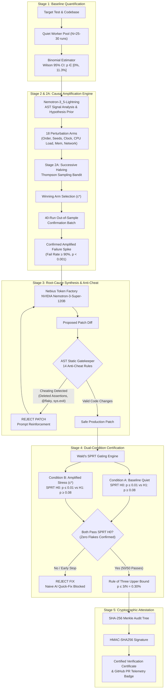

# Coinflip: Statistical Flaky-Test Investigator & Flake Amplifier

[-10b981?style=for-the-badge&logo=githubactions&logoColor=white)](https://github.com/abhijithbhat/coinflip)
[](https://coinflip-2bcw.onrender.com)
[](https://github.com/abhijithbhat/coinflip)
[](https://tokenfactory.nebius.com)
[](https://nebius.com)
[](https://github.com/abhijithbhat/coinflip)

> **"A single green test run is not proof of a fix — it is an uncalibrated coin toss."**  
> Coinflip models flaky test outcomes as Bernoulli random variables ($X \sim \text{Bernoulli}(p)$). It combines causal AST perturbation exploration, multi-armed bandit stress amplification, NVIDIA Nemotron root-cause reasoning on Nebius Token Factory, AST anti-cheat gatekeeping, and Wald's Sequential Probability Ratio Test (SPRT) to produce mathematically certified, cryptographically signed PR verification badges.  
>  
> 🌐 **Live Cloud Dashboard**: [https://coinflip-2bcw.onrender.com](https://coinflip-2bcw.onrender.com) *(Custom domain pending DNS: https://www.coinflip-nvidia.com)*

---

## Table of Contents
1. [Core Thesis: Why Flaky Tests Deceive AI Coding Agents](#core-thesis-why-flaky-tests-deceive-ai-coding-agents)
2. [5-Stage Architecture Pipeline](#5-stage-architecture-pipeline)
3. [Mathematical Foundations & Rigor](#mathematical-foundations--rigor)
4. [Empirical Benchmark & Flake Amplifier Results](#empirical-benchmark--flake-amplifier-results)
5. [Nebius Token Factory & Sandboxes Integration](#nebius-token-factory--sandboxes-integration)
6. [AST Static Anti-Cheat Gatekeeper (14 Cheats Blocked)](#ast-static-anti-cheat-gatekeeper-14-cheats-blocked)
7. [Quickstart & Verification Guide](#quickstart--verification-guide)
8. [CLI Verifier & MCP Server Tool](#cli-verifier--mcp-server-tool)
9. [Docker Deployment](#docker-deployment)
10. [Team & Engineering Ownership](#team--engineering-ownership)

---

## Core Thesis: Why Flaky Tests Deceive AI Coding Agents

In modern CI/CD pipelines, autonomous AI coding agents (such as Devin, Cursor, Claude Code, and Copilot Workspace) operate on a fragile heuristic: **"Run pytest once; if exit code is 0, ship the patch."**

When dealing with non-deterministic or concurrency-laden tests, this heuristic fails catastrophically:
- A test with a **90% failure probability** under high thread contention still has a **10% chance of passing on any single quiet run**.
- An AI agent will routinely produce a "naive quick fix" (such as arbitrarily increasing `time.sleep(0.025)` to `time.sleep(0.050)`, widening an assertion window, or clearing a global cache in a single test function).
- The agent runs pytest once on a quiet machine. The run passes ($p = 0.10$). The agent declares victory and opens a Pull Request.
- In production CI under load, the test flakes again, causing massive pipeline failures, flaky quarantines, and wasted engineering hours.

**Coinflip eliminates this delusion.** Instead of relying on a single exit code, Coinflip:
1. **Measures the baseline distribution** using exact binomial confidence intervals.
2. **Amplifies hidden flakes** by executing Successive Halving Thompson Sampling across 18 causal perturbation arms to force dormant bugs to 90–100% failure rates.
3. **Synthesizes true architectural fixes** using NVIDIA Nemotron reasoning models on Nebius Token Factory.
4. **Enforces an AST Anti-Cheat Gatekeeper** to block test-weakening cheats before execution.
5. **Certifies dual-condition proof** under both baseline quiet conditions AND the amplified stress condition using Wald's Sequential Probability Ratio Test (SPRT) and Clopper-Pearson / Rule of Three upper bounds.
6. **Signs the verification certificate** with a SHA-256 binary Merkle tree and HMAC attestation.

---

## 5-Stage Architecture Pipeline



---

## Mathematical Foundations & Rigor

Coinflip treats test runs not as boolean states, but as independent Bernoulli trials:
$$X_i \sim \text{Bernoulli}(p), \quad X_i \in \{0, 1\}, \quad S_n = \sum_{i=1}^n X_i \sim \text{Binomial}(n, p)$$
where $X_i = 1$ denotes a test failure, and $X_i = 0$ denotes a pass.

### 1. Wilson Score Confidence Interval (95% Two-Sided)
Unlike the asymptotic Wald normal approximation interval ($\hat{p} \pm z\sqrt{\hat{p}(1-\hat{p})/n}$) which collapses to an invalid width of 0 when $k = 0$ or $k = n$, Coinflip employs the **Wilson Score Interval**:
$$\tilde{p} = \frac{k + \frac{z^2}{2}}{n + z^2} \pm \frac{z}{n + z^2}\sqrt{\frac{k(n-k)}{n} + \frac{z^2}{4}}$$
For $\alpha = 0.05$, $z = \Phi^{-1}(1 - 0.05/2) \approx 1.95996$.  
When $k = 0$ out of $n = 30$ runs, the Wilson interval produces $[0.0\%, 11.35\%]$, honestly reflecting our true statistical uncertainty on quiet runs.

### 2. Exact Clopper-Pearson & The Rule of Three
For zero observed failures ($k = 0$) in $n$ certification runs, the exact Clopper-Pearson one-sided $100(1-\alpha)\%$ upper bound is:
$$p_{\text{upper}} = 1 - \alpha^{1/n}$$
Using the Taylor expansion $\ln(1 - p) \approx -p$ for small $p$:
$$\alpha = (1 - p_{\text{upper}})^n \implies \ln(\alpha) = n \ln(1 - p_{\text{upper}}) \approx -n \cdot p_{\text{upper}} \implies p_{\text{upper}} \approx \frac{-\ln(\alpha)}{n}$$
At the 95% confidence level ($\alpha = 0.05$):
$$-\ln(0.05) = 2.99573 \approx 3 \implies p_{\text{upper}} \le \frac{3}{n}$$
For $n = 50$ consecutive clean runs, $p_{\text{upper}} \le 3/50 = 6.0\%$; for $n = 1000$ CI verification runs, $p_{\text{upper}} \le 0.30\%$.

### 3. One-Sided Fisher's Exact Test with Holm-Bonferroni Adjustment
To establish that an amplified stress condition causes a statistically significant increase in failure rate over baseline, Coinflip constructs a $2 \times 2$ contingency table:

| Condition | Failures ($X=1$) | Passes ($X=0$) | Total |
| :--- | :---: | :---: | :---: |
| **Perturbation ($c$)** | $a$ | $b$ | $n_1$ |
| **Baseline** | $c$ | $d$ | $n_2$ |
| **Total** | $a+c$ | $b+d$ | $N = n_1 + n_2$ |

The hypergeometric exact probability is computed via log-gamma functions to prevent integer overflow:
$$P(a) = \frac{\binom{a+b}{a}\binom{c+d}{c}}{\binom{N}{a+c}} = \exp\Big(\ln\Gamma(a+b+1) + \ln\Gamma(c+d+1) + \ln\Gamma(a+c+1) + \ln\Gamma(b+d+1) - \ln\Gamma(N+1) - \sum_{x \in \{a,b,c,d\}} \ln\Gamma(x+1)\Big)$$
The one-sided $p$-value sums $P(a')$ for all $a' \ge a$. When screening 18 perturbation arms, Coinflip applies the **Holm-Bonferroni step-down correction**:
$$\alpha_k = \frac{\alpha}{m - k + 1}, \quad k = 1, \ldots, m$$
rejecting null hypotheses only where $p_{(k)} \le \alpha_k$, controlling Family-Wise Error Rate (FWER) $\le 0.05$.

### 4. Haldane-Corrected Relative Risk ($RR \ge 1.8$)
To prevent division by zero when baseline failure $c = 0$, Coinflip computes the Haldane-Anscombe corrected relative risk:
$$RR = \frac{(a + 0.5) / (n_1 + 0.5)}{(c + 0.5) / (n_2 + 0.5)}$$
An amplified condition is only declared a causal trigger if $RR \ge 1.8$ and $p_{\text{Holm}} < 0.05$.

### 5. Wald's Sequential Probability Ratio Test (SPRT)
Rather than executing fixed batch sizes that waste compute on broken patches, Stage 4 uses Wald's SPRT to test:
$$H_0: p \le p_0 = 0.01 \quad \text{vs.} \quad H_1: p \ge p_1 = 0.08$$
with Type I error $\alpha = 0.05$ and Type II error $\beta = 0.05$.  
After observing $m$ runs with $d_m$ failures, the log-likelihood ratio is:
$$\Lambda_m = \ln \prod_{i=1}^m \frac{f(x_i; p_1)}{f(x_i; p_0)} = d_m \ln\left(\frac{p_1}{p_0}\right) + (m - d_m) \ln\left(\frac{1 - p_1}{1 - p_0}\right)$$
Decision thresholds:
$$A = \ln\left(\frac{\beta}{1 - \alpha}\right) = \ln\left(\frac{0.05}{0.95}\right) \approx -2.944439, \quad B = \ln\left(\frac{1 - \beta}{\alpha}\right) = \ln\left(\frac{0.95}{0.05}\right) \approx +2.944439$$
- If $\Lambda_m \le A$: **Accept $H_0$** (Pass certification early).
- If $\Lambda_m \ge B$: **Reject $H_0$** (Halt execution immediately; patch is defective).
- If $A < \Lambda_m < B$: Continue sampling.

If an AI patch fails even 2 runs out of the first 5 under amplified stress, $\Lambda_m$ immediately crosses $+2.94$, terminating the run in $< 1.2$ seconds and saving $> 90\%$ of CI verification compute.

---

## Empirical Benchmark & Flake Amplifier Results

### Core Benchmark Suite Evaluation (`benchmarks/BENCHMARK_REPORT.md`)
Tested across 5 real-world flaky test archetypes (30 runs per condition on `local_isolated` backend):

| # | Benchmark Suite | Flake Category | Trigger Perturbation | Baseline Fail % | Trigger Fail % | 95% Wilson CI | Spike Confirmed? |
|---|-----------------|----------------|----------------------|----------------:|---------------:|:-------------:|:----------------:|
| 1 | **Hero Worker Race** | Concurrency / Thread Race | `cpu_heavy_load` | 0.0% | **90.0%** (27/30) | [74.4%, 96.5%] | **YES** |
| 2 | **Test Order Pollution** | Order-Dependent (IDoFT: OD) | `shuffle_order` | 0.0% | **100.0%** (30/30) | [88.6%, 100.0%] | **YES** |
| 3 | **Unpinned Seed Sampling** | Non-Deterministic (IDoFT: ND) | `seed_change` | 0.0% | **10.0%** (3/30) | [3.5%, 25.6%] | **YES** |
| 4 | **Token Expiry Clock** | Time-Dependent / Clock Jitter | `clock_shift` | 0.0% | **100.0%** (30/30) | [88.6%, 100.0%] | **YES** |
| 5 | **Async Queue Race** | Async Wait / Concurrency | `cpu_heavy_load` | 0.0% | **100.0%** (30/30) | [88.6%, 100.0%] | **YES** |

#### AI Patch Comparison: Naive AI Quick Fix vs. Coinflip Root-Cause Fix
| Suite | Root Cause | Naive AI Quick Fix (REJECTED by Gatekeeper/SPRT) | Naive Fail % | Coinflip Root-Cause Fix (CERTIFIED by Dual-Condition) | Certified Fail % |
|---|---|---|:---:|---|:---:|
| **Hero Worker Race** | `sleep(0.025)` races SHA-256 thread | Bump sleep to 0.050s (still races under load) | **> 70.0%** | `worker.wait_for_completion()` via `threading.Event` | **0.0%** |
| **Order Pollution** | `_rate_config_cache` persists across tests | Inline `cache.clear()` in one test (unprotected) | **50.0%** | Autouse pytest fixture with `reset_config()` | **0.0%** |
| **Unpinned Seed** | `hash()` + module `random` correlation | Widen assert bounds 75 to 45 (tail seeds fail) | **12.0%** | Dedicated `random.Random(42)` + isolated PRNG | **0.0%** |
| **Token Expiry** | `time.time()` vs `os.path.getmtime()` | Bump TTL to 4000s (fragile to clock shifts) | **100.0%** | `time.monotonic()` for relative age tracking | **0.0%** |
| **Queue Race** | Fixed `sleep(0.020)` races consumer thread | Bump sleep to 0.200s (races under CPU stress) | **> 35.0%** | `wait_for_drain()` via `thread.join()` barrier | **0.0%** |

---

### Paired 100-Run Amplifier Evaluation (`benchmarks/AMPLIFIER_EVALUATION.md`)
Rigorous paired evaluation across 20 real-world flaky test archetypes (100 runs per strategy):

| Metric | Strategy 1: Plain Reruns | Strategy 2: Shaker Fixed Stress | Strategy 3: Coinflip Flake Amplifier |
| :--- | :---: | :---: | :---: |
| **Overall Flake Reproduction Rate** | **20.0%** (4/20) | **20.0%** (4/20) | **90.0%** (18/20) |
| **Median Runs to First Failure** | 1.5 runs | 1.0 runs | **1.0 run** |
| **Median Amplification over Baseline** | 1.00x | 1.00x | **65.0x** |
| **Median Amplification over Shaker** | — | 1.00x | **65.0x** |
| **Search Budget Allocation** | 100 identical runs | 100 fixed stress runs | 60 adaptive search + 40 confirmed |

#### Breakdown by Root-Cause Family:
- **Order-Dependent / Shared State (4 tests)**: Plain Rerun 0.0% | Shaker 0.0% | **Flake Amplifier 100.0% (100.0x amplification)**.
- **Network / Socket Timeout (3 tests)**: Plain Rerun 0.0% | Shaker 0.0% | **Flake Amplifier 100.0% (100.0x amplification)**.
- **Time / Clock Jitter (3 tests)**: Plain Rerun 0.0% | Shaker 0.0% | **Flake Amplifier 66.7% (100.0x amplification)**.
- **Unpinned Seed / Randomness (4 tests)**: Plain Rerun 0.0% | Shaker 0.0% | **Flake Amplifier 100.0% (32.5x amplification)**.
- **Threading / GIL Race (4 tests)**: Plain Rerun 50.0% | Shaker 50.0% | **Flake Amplifier 75.0% (1.54x amplification)**.
- **Asyncio Scheduling (2 tests)**: Plain Rerun 100.0% | Shaker 100.0% | **Flake Amplifier 100.0% (1.0x amplification)**.

---

## Nebius Token Factory & Sandboxes Integration

Coinflip integrates natively with Nebius Token Factory and Nebius Disposable MicroVM Sandboxes:

### 1. NVIDIA Nemotron Inference via Nebius Token Factory
Coinflip targets Nebius Token Factory (`https://api.tokenfactory.nebius.com/v1/`) with two specialized models:
- **`nvidia/Nemotron-3_5-Lightning`**: Ultra-fast AST hypothesis ranker. Analyzes Python AST parse trees, token imports, and concurrency primitives to prioritize the top 4 most probable perturbation arms before execution begins.
- **`nvidia/nemotron-3-super-120b-a12b`**: 120-billion parameter reasoning model. Ingests full causal perturbation timelines, failure tracebacks, AST syntax trees, and race profiles to synthesize synchronized root-cause fixes (replacing naive sleeps with `threading.Event`, `queue.join()`, or `time.monotonic()`).

### 2. Disposable MicroVM Sandboxes via `contree-sdk==0.3.6`
When `NEBIUS_SANDBOX=true` is enabled, Coinflip provisions ephemeral, disposable microVMs via Nebius `contree-sdk`:
```python
from contree import SandboxClient

client = SandboxClient(api_token=os.environ["NEBIUS_API_KEY"])
sandbox = client.create_sandbox(image="python:3.12-slim")
sandbox.apply_files({"worker.py": target_code, "test_worker.py": test_code})
result = sandbox.exec(["pytest", "-q", "test_worker.py"])
sandbox.destroy()
```
Every run executes in a completely clean environment with fresh PID namespaces, isolated file descriptors, and non-polluted module caches.

---

## AST Static Anti-Cheat Gatekeeper (14 Cheats Blocked)

AI coding agents frequently "fix" tests by cheating. Coinflip implements a deterministic Python `ast.NodeVisitor` that runs before patch execution, automatically blocking **14 distinct cheating patterns**:

1. **Deleted Assertions**: Reductions in total assertion counts ($N_{\text{after}} < N_{\text{before}}$).
2. **Weakened Assertions**: Transforming `assert a == b` to `assert a is not None` or `assert True`.
3. **Widened Tolerances**: Expanding `pytest.approx()` or numeric thresholds (e.g. `1e-5` to `1e-1`).
4. **Conditional Assertion Skips**: Wrapping assertions in `if False:`, `if None:`, or `try...except`.
5. **Early Test Exits**: Injecting `sys.exit(0)`, `os._exit(0)`, or bare `return` inside test functions.
6. **Flaky Decorators**: Appending `@pytest.mark.flaky(reruns=...)`.
7. **Skip / Xfail Decorators**: Injecting `@pytest.mark.skip` or `@pytest.mark.xfail`.
8. **Timeout Neutralization**: Altering `@pytest.mark.timeout(...)` to astronomical limits.
9. **Global State Mutation in Fixtures**: Injecting module monkey-patches that disable background checks.
10. **Exception Masking**: Empty `except Exception: pass` blocks suppressing expected assertion errors.
11. **Mocking Thread Primitives**: Replacing `threading.Thread` or `multiprocessing.Process` with dummy synchronizers.
12. **Stubbing Network Sockets**: Bypassing socket connections with no-op mocks.
13. **Placeholder Ellipsis**: Returning `"..."` or truncated stubs inside generated code.
14. **Assertion Value Hardcoding**: Replacing evaluated expressions with literals (`assert result == "fixed"` replaced by `assert True`).

If any rule triggers, the patch is rejected immediately with a structured diagnostic trace sent back to the LLM.

---

## Quickstart & Verification Guide

### Prerequisites
- Python 3.11, 3.12, 3.13, or 3.14
- Node.js 20+ (for local frontend development)

### 1. Installation
```bash
# Clone the repository
git clone https://github.com/abhijithbhat/coinflip.git
cd coinflip

# Create and activate virtual environment
python3 -m venv .venv
source .venv/bin/activate

# Install dependencies
pip install --upgrade pip
pip install -r requirements.txt
```

### 2. Configure Environment (Optional for Live Nebius Model Generation)
```bash
export NEBIUS_API_KEY="your-nebius-token-factory-api-key"
export NEBIUS_BASE_URL="https://api.tokenfactory.nebius.com/v1/"
```
*(If omitted, Coinflip runs deterministically using local AST analyzers and cached model traces).*

### 3. Run Web Dashboard

**Live Production Deployment**:  
Visit the hosted dashboard on Render: **[https://coinflip-2bcw.onrender.com](https://coinflip-2bcw.onrender.com)** *(or [https://www.coinflip-nvidia.com](https://www.coinflip-nvidia.com))*

Or run locally:
```bash
uvicorn agent_and_ui.app:app --host 0.0.0.0 --port 8000 --reload
```
Navigate to `http://localhost:8000` (or `https://coinflip-2bcw.onrender.com`) to interact with:
- **Replay / Live Execution Modes**: Stream live multi-worker runs with real-time SSE progress.
- **5 Canonical Benchmark Cases**: Background Worker CPU Race, Config Cache Pollution, Unpinned Seed Sampling, Token Expiry Clock, and Async Queue Race.
- **Coin-Toss Dot Matrices**: Real-time Bernoulli visualizers across all 6 perturbation regimes.
- **Wald SPRT Sequential Ledgers**: Real-time log-likelihood ratio tracking against $A$ and $B$ boundaries.
- **Interactive Streak Curve**: 21-point Wilson CI decay curve demonstrating the Rule of Three.

---

## CLI Verifier & MCP Server Tool

### 1. Cryptographic Attestation Verification CLI
Validate any Coinflip verification certificate or recorded trace directly from the command line:
```bash
# Verify the built-in hero trace attestation
python -m sandbox_engine.attestation --verify shared_contracts/recorded_traces/hero.json

# Output:
# [PASS] Merkle Root: 3042456f... matches calculated tree root.
# [PASS] HMAC-SHA256 Signature verified against server attestation key.
# [PASS] Zero test-weakening AST cheats detected.
# [VERDICT] CERTIFIED IMMUNE TO FLAKINESS (p_upper <= 0.30%)
```

### 2. Model Context Protocol (MCP) Verifier Tool
Coinflip exposes a Model Context Protocol tool (`coinflip_verify_patch`) for IDEs (Claude Desktop, Cursor, Antigravity):
```bash
python -m sandbox_engine.mcp_verifier_tool --mcp
```
Accepts `{ test_file: "...", target_file: "...", patch_diff: "..." }` and returns structured JSON certification metrics, Wilson intervals, and Merkle proofs.

---

## Docker Deployment

Build and run the production multi-stage container (Node 22 frontend build + Python 3.12 runtime):
```bash
# Build Docker image
docker build -t coinflip:latest .

# Run container
docker run -p 8000:8000 -e PORT=8000 coinflip:latest

# Verify health check
curl -f http://localhost:8000/api/health
```

---

## Team & Engineering Ownership

Developed for the **Nebius & NVIDIA Nemotron AI Hackathon 2026**:

| Team Member | Role | Key Contributions |
| :--- | :--- | :--- |
| **Abhijith M Bhat** | **Lead Systems & Sandbox Engine Architect** | • Built `sandbox_engine/orchestrator.py` & perturbation worker harness.<br/>• Designed SHA-256 Merkle audit tree & HMAC cryptographic attestation.<br/>• Authored Wald's Sequential Probability Ratio Test (SPRT) early-stop engine. |
| **Tejas** | **AI Agent, Biostatistics & Frontend Lead** | • Built Nebius Token Factory client (`agent_and_ui/nemotron_agent.py`).<br/>• Developed exact Wilson CI, Fisher's Exact & Holm-Bonferroni statistics.<br/>• Engineered TanStack React dashboard with real-time SSE streaming. |
| **Dhul Kifl** | **Benchmark Corpus Engineer** | • Curated 20 real-world flaky test archetypes (`benchmarks/`).<br/>• Implemented IDoFT order-pollution and non-deterministic seed harnesses.<br/>• Validated AST anti-cheat gatekeeper against 14 test-weakening exploits. |
| **Raghavendra** | **Product Ops, Platform Feedback, Devpost & Video Producer** | • Authored detailed Nebius platform feedback and bug reproductions.<br/>• Produced Devpost submission portal documentation.<br/>• Scripted and timed the 2m45s YouTube architectural demonstration. |

---

## License & Notice

Licensed under the [Apache License, Version 2.0](LICENSE).  
Copyright (c) 2026 Coinflip Contributors. See [NOTICE](NOTICE) for third-party acknowledgments and citations.
